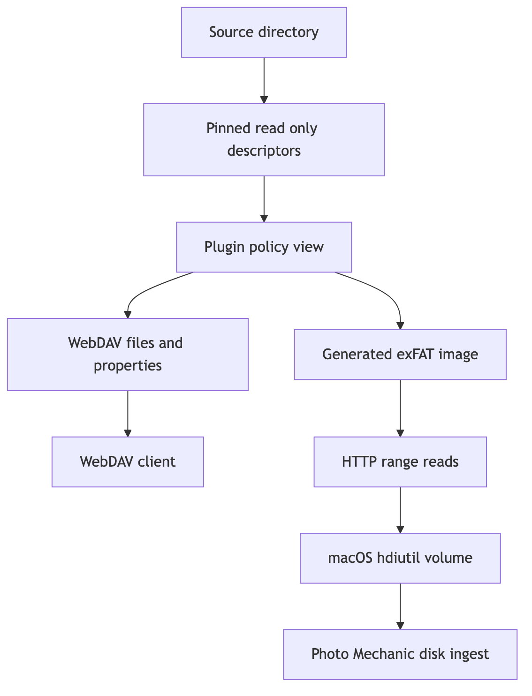

# diskproxy: virtual disks for stable camera ingest and offline photo libraries


A camera card I had already ingested started copying from the beginning after
my laptop changed timezones. The pictures were still there, the card identity
was still there, and the filenames had not changed. I wanted to resume an
interrupted ingest, not import thousands of old files again.

That problem became [diskproxy](https://github.com/firstpair/diskproxy), a Rust
program that presents a directory through a controlled filesystem view that
never writes to its source. It can expose files through WebDAV, serve a
generated exFAT disk over HTTP, or serve a writable NFS volume whose writes stay
in the session. Application-specific behavior lives in plugins. The first plugin
restores a stable ingest convention for Photo Mechanic Plus. A second one serves
a whole photo library from Lightroom Smart Previews and preview JPEGs, with
sharp previews and no copied image data, and saves the ratings you make on it. Both use the same source access,
HTTP server, and disk generator.

The interesting part is where the failure occurred: between a filesystem's
wall-clock timestamp and an application's expectation that modification time
is a stable part of file identity.

## The card that looked new again

Photo Mechanic calls copying photographs from a camera card to their destination
an ingest. Its Incremental Ingest option is intended to copy only photos new
since the previous ingest on that computer. That per-computer scope is part of
[Camera Bits' documented workflow](https://docs.camerabits.com/support/solutions/articles/48000207409-ingesting-photos).

In the local history files we inspected, an entry combined a card-relative path,
file size, and an epoch modification timestamp. The card's `.pmingest.dat`
contained the GUID selecting a history file under:

```text
~/Library/Caches/Photo Mechanic/ingest/incremental/<GUID>
```

A representative entry referred to `DCIM/100LEICA/ALXY8703.DNG`, a file of
42,484,224 bytes. Its recorded modification time in the original Pacific-time
ingest history was `1789413132`.

Rebuilding that history from the currently mounted card, and leaving out genuinely
new files, made incremental ingest behave again. That was useful evidence: the
application could recognize the existing pictures when supplied with matching
status data. It was also an inconvenient repair to repeat while traveling,
especially after an interrupted ingest.

The modification times provided the explanation. The same on-card wall-clock
value, September 14, 2026 at 12:12:12, became different epoch values on different
mounts:

| Timezone used for the mount | Reported epoch mtime | Change from the original history |
| --- | ---: | ---: |
| Pacific daylight time, UTC−07:00 | 1789413132 | 0 seconds |
| Shanghai, UTC+08:00 | 1789359132 | −54,000 seconds |
| Tokyo, UTC+09:00 | 1789355532 | −57,600 seconds |

Those differences are exactly fifteen and sixteen hours. The application was
being handed different timestamps for the same source entries.

## Epoch time was not the thing changing

Unix epoch timestamps identify instants independently of timezone. The conversion
*into* an epoch timestamp still needs a timezone if its input is only a local
clock reading. “12:12:12” without an offset does not identify one instant.

The inspected card came from a Leica M10-R running firmware 30.22.23.34. Its
exFAT creation and modification offset bytes were `0x00` on the 9,037 image
entries examined. In exFAT, an offset includes a validity bit. When it is invalid,
the specification directs implementations to use the current local offset for
the corresponding timestamp. This behavior is described in
[the exFAT timestamp specification](https://learn.microsoft.com/en-us/windows/win32/fileio/exfat-specification#74102-offsetvalid-field).

In our macOS tests, the timezone in effect at mounting determined the conversion.
Changing the laptop's timezone while the card remained mounted did not immediately
change the reported file times; remounting did. The camera's timezone menu had
not supplied a usable offset in those filesystem fields.

That observation belongs to this card and workflow. It does not establish that
every Leica model, firmware version, or filesystem driver behaves identically.
It does establish why a path/size/mtime comparison failed here.

The camera's EXIF capture time is a separate part of the story. Correcting an
incorrect camera clock, deciding which local date belongs in a filename, and
normalizing filesystem metadata for ingest are different operations. Diskproxy
handles the filesystem view. It does not rewrite EXIF or infer the actual place
and timezone in which a photograph was taken.

## WebDAV gave us a filesystem view in user space

WebDAV means **Web Distributed Authoring and Versioning**. It extends HTTP with
properties, collections, and operations for managing resources. A collection
can represent a directory, and `PROPFIND` lets a client ask for metadata and
members. That is the useful filesystem-like layer over ordinary HTTP.
[RFC 4918](https://www.rfc-editor.org/rfc/rfc4918.html) defines the protocol.

That made WebDAV an attractive first interface. A small local server could read
the physical card, return stable modification times, and let a mounted client
see the resulting tree. The photographs did not need to be staged into another
directory before ingest.

The implementation serves a deliberately read-only subset:

| Request | What diskproxy does |
| --- | --- |
| `OPTIONS` | Advertises the available DAV/read methods. |
| `PROPFIND` | Returns properties for an entry or one level of children. |
| `GET` | Streams the visible file's bytes. |
| `HEAD` | Returns its headers without the body. |

For example, a client can ask for names, lengths, and modification times beneath
a collection. Diskproxy formats a `207 Multi-Status` XML response. It checks the
namespace and local property name rather than assuming the client's XML prefix
will be `D` or `DAV`. It escapes values, encodes URL components, and gives unknown
properties their own failure status inside the response.

The server rejects mutation requests. A file's visible modification time comes
from the selected policy; its bytes come from the source descriptor. A policy
can also omit a file. Direct requests for an omitted file are checked too, so
filtering does more than remove a name from a listing.

A low-level WebDAV session looks like this:

```sh
diskproxy-server serve /path/to/folder --plugin passthrough --mode webdav
```

The server prints a localhost URL containing a random capability token. A WebDAV
client can mount that URL. The ordinary `diskproxy start` workflow uses the disk
transport described below, so normal ingest does not involve copying that URL.

## A folder view was not enough for this ingest workflow

The first unfiltered WebDAV attempt corrected timestamps, but Photo Mechanic did
not list it as a camera disk. Selecting the mounted share as a folder led to a
second mismatch: the application recorded folder and disk ingest paths differently.

We observed both forms for the same relative photo path:

```text
/DCIM/100LEICA/ALXY7590.DNG
DCIM/100LEICA/ALXY7590.DNG
```

The leading slash was enough to matter to that history comparison. In the failed
trial, ingest began copying previously ingested frames again. Correcting only
the modification time had left another part of the application's source identity
contract unsatisfied.

Two useful responses came out of that result. A filtering policy could normalize
those path forms and hide exact matches from the view. And a virtual disk could
preserve the disk-style source interface that the successful workflow expected.
WebDAV remains an alternative transport; the current PMP ingest launcher uses
the virtual disk.

## The virtual disk is generated over HTTP

Disk mode exposes one resource, `card.img`, as a read-only exFAT disk image.
macOS attaches it with `hdiutil` and presents an ordinary mounted volume that
Photo Mechanic can select under **Disks**.

This is an HTTP-backed disk image, rather than a WebDAV-mounted directory. Its
client reads disk-image byte offsets. HTTP Range requests allow transfer of a
portion of a representation, as specified in
[RFC 9110](https://www.rfc-editor.org/rfc/rfc9110.html#section-14.2). Diskproxy
supports single byte ranges, including suffix and open-ended forms.

The image does not have to exist as a large file on the laptop. Diskproxy builds
its boot structures, allocation information, directory entries, and other
filesystem metadata in memory. File-data extents refer back to the original
source files. A read can therefore be answered from generated metadata, zero
padding, or the appropriate range of source bytes.

The resulting data path has two possible client interfaces:



The virtual exFAT entries contain valid UTC offsets. The policy determines the
epoch timestamp; the disk generator encodes it in UTC. This removes the unknown-
offset conversion that caused the original remount problem.

The legacy card's virtual view matched all 7,777 known file entries in the checked
history. Ingest then resumed at frame 1480, the expected first new frame. A full
SHA-256 comparison of that representative DNG matched between source and view.
Later, a new card registered with a UTC convention was ingested successfully.
Those were workflow checks, rather than a throughput benchmark or a claim about
all cameras.

## The core owns the transports and the plugin owns the policy

The first implementation naturally accumulated camera-specific assumptions:
`DCIM`, `.pmingest.dat`, ingest-history rows, and timezone corrections. Extracting
it into diskproxy made those boundaries explicit.

The reusable core opens a source root, validates traversals, provides metadata,
streams files, and generates the disk. The PMP plugin supplies the camera layout,
card identity, timestamp convention, and optional history filtering. Configuration
and CLI selection live in the application. The shell launcher owns attachment
and process lifecycle.

The plugin trait started with three hooks:

```rust
fn visible(&self, parts: &[String], metadata: &Metadata) -> Result<bool>;
fn mtime(&self, parts: &[String], metadata: &Metadata) -> Result<i64>;
fn identity(&self) -> Option<String>;
```

Default implementations expose the entry, retain its modification time, and let
the core derive volume identity from the source. A simple visibility policy only
needs to override the first method. A timestamp policy can retain every file and
override the second. The PMP plugin uses a stable card identifier for the third.

A `View` combines a pinned `Source`, an `Arc<dyn Plugin>`, and a volume label.
Both transports use that same view. The core's source opens remain read-only
regardless of a visibility or timestamp decision.

Plugins are trusted Rust code linked into the binary. They are not dynamically
loaded scripts, and the trait is not a sandbox. A user-written plugin can call
other APIs; keeping setup writes small and explicit is part of writing a policy
responsibly.

## A UTC card is a stable ingest convention

For a fresh card with no prior ingest history, UTC is a convenient target. It
avoids having to remember whether that card first met the application in
Shanghai, Tokyo, or the Pacific timezone.

The target is an ingest convention. It does not assert that an offset-free EXIF
clock reading was UTC when the photograph was taken. A legacy card whose history
was established using Pacific daylight time must retain that convention until
its history is deliberately migrated. The saved profile prevents an accidental
target change.

The portable profile lives on the card as `.pmp-ingest-proxy.json`. It records
the GUID, target convention, and up to three sampled image fingerprints with
filesystem wall-clock anchors. Subsequent mounts can reconstruct the source
mount offset from unchanged samples. It does not infer that offset by treating
EXIF as a trusted clock.

Hashing a few samples serves a different purpose from filtering all ingest
history. The profile checks whether a sample is still the same file before using
its timestamp anchor. History filtering compares each candidate's relative path,
size, and presented mtime; it is not a whole-card content-deduplication service.

A profile travels between Macs, but Photo Mechanic's ingest progress remains
local to each computer. Another Mac does not automatically inherit the first
Mac's history. The filtered policy needs an available trusted history snapshot;
a profile alone does not tell it what another computer copied.

## Registration and ingestion now have short commands

Install the PMP use case from the repository:

```sh
git clone https://github.com/firstpair/diskproxy.git
cd diskproxy
scripts/install.sh --config configs/pmp.json
```

The installer preserves an existing default config; the
[PMP guide](https://github.com/firstpair/diskproxy/blob/main/plugins/pmp/README.md)
explains explicit config selection when one is already present. Once the PMP
config is the default, a new card needs one setup command:

```sh
diskproxy-server
```

It loads the default config, assumes the Mac's current UTC offset for the new
mount, selects UTC for a new card without history, writes the marker/profile,
and exits. If `diskproxy start` encounters an unregistered card first, its normal
message is simply:

```text
Run diskproxy-server.
```

Non-default paths or configs are included only when needed. Invalid configuration
or unverified existing samples produce diagnostics and override options. Repeating
the bare registration command on an established card reuses its profile.

Initial offset inference has a clear boundary: if the computer's timezone changed
*after* the card was mounted, the current offset may not describe that mount.
Remount first or specify the known mount offset, for example
`diskproxy-server --source-offset=+09:00`. An old card without a profile or usable
local history also needs its historical target convention supplied deliberately;
it should not be casually assigned a new UTC identity.

Ordinary sessions are shorter still:

```sh
diskproxy start
# Ingest the virtual volume under Disks in PMP.
diskproxy stop
```

The launcher starts the server, reads its capability URL, and attaches the disk.
Stop verifies the volume identity and detaches before terminating the server.
If macOS reports the volume busy, the server remains alive so an application
reading it can finish. The historical volume label, `PMP Pacific`, remains a
compatibility default even for UTC profiles; it does not determine the timestamp
policy.

Intended EXIF corrections should be completed and reviewed before profile
sampling, or handled on ingested destinations through the chosen catalog
workflow. Editing sampled source files later can invalidate the anchors. The
proxy preserves source photo bytes during serving and never renames pictures.

## Adding a plugin is a concrete build step

A general-purpose tool needs an extension path that another developer can
actually follow. The repository now contains a small, compiled reference crate
at `examples/hide-plugin` and a complete
[plugin development guide](https://github.com/firstpair/diskproxy/blob/main/docs/plugins.md).

The example accepts exact names and suffixes to exclude. Its core decision is:

```rust
impl Plugin for Hide {
    fn visible(&self, parts: &[String], _metadata: &Metadata) -> Result<bool> {
        Ok(!parts.iter().any(|part| {
            self.config.exclude_names.contains(part)
                || self.config.exclude_suffixes.iter()
                    .any(|suffix| part.ends_with(suffix))
        }))
    }
}
```

Checking every component is intentional. Hiding `cache` in a listing should also
hide `cache/secret.txt` when a client asks for that URL directly. The example's
constructor rejects malformed or empty match rules, and its default timestamp
and identity hooks leave those parts of the view alone.

The reference crate is tested as a workspace member. Selecting it from the CLI
requires registration in the application; it is not another automatically
loaded plugin. The required integration is specific:

1. Add the crate to the Cargo workspace and the application's dependencies.
2. Add its name to the Serde/Clap `PluginName` enum.
3. Deserialize and validate `plugins.<name>` before any setup I/O.
4. Add the construction arm that returns the pinned source, policy object,
   startup information, and default label.
5. Update the lockfile, build, and test both visible and hidden access paths.

The included `register.patch` performs those application edits for the example.
It has been applied and compiled in an isolated copy, then exercised through
WebDAV against a synthetic tree. It checked retained bytes, filtered listings,
direct requests for excluded descendants, and preservation of the physical files.
To reproduce that integration from the root of an experimental checkout:

```sh
git apply --check examples/hide-plugin/register.patch
git apply examples/hide-plugin/register.patch
cargo test --workspace --locked
```

After registering the example, save its definitions as `my-hide.json`, using
an absolute source path:

```json
{
  "source": "/absolute/path/to/folder",
  "plugin": "hide",
  "label": "HideDemo",
  "plugins": {
    "hide": {
      "exclude_names": ["cache", ".DS_Store"],
      "exclude_suffixes": [".tmp"]
    }
  }
}
```

Build/install that integrated binary, then the familiar lifecycle remains:

```sh
scripts/install.sh
diskproxy --config ./my-hide.json start
diskproxy stop
```

Or change a definition for one session:

```sh
diskproxy start --config ./my-hide.json \
  --set 'plugins.hide.exclude_suffixes=[".tmp",".bak"]'
```

The shipped application continues to select its built-in passthrough, PMP or
previews policy until those example registry changes are applied. The two hooks
added later, for file content and client writes, are described next. The API
still does not rename paths, synthesize files absent from the source, or chain
several policies.

## A photo library served from its previews

The second use case came from the other end of the workflow. A large Lightroom
Classic library kept its originals on an external drive, but every photo also
had a Smart Preview on the laptop: a small lossy DNG, 2560 pixels on its long
edge, that Lightroom uses when the original is offline. Photo Mechanic Plus,
which browses far faster than Lightroom, had its own catalog of 1600-pixel
preview JPEGs for the same photos. I wanted to browse, rate and export the whole
library in Photo Mechanic while the drive was in a drawer.

Pointing Photo Mechanic at the Smart Previews nearly works. They are real DNGs
with the photo's metadata, and raw-capable software can render them. But Photo
Mechanic shows a file's embedded preview, and a Smart Preview embeds only a tiny
thumbnail. The sharp preview existed, in a different folder, under a different
name.

So the stand-in tree was built from APFS clones of the Smart Previews, arranged
under the originals' folder layout. A clone shares its blocks with the file it
was cloned from, so 1,256,465 stand-ins cost almost no disk space. A map file
then pairs each stand-in with its preview JPEG:

```text
2024/trip/IMG_0001.DNG	preview=a1/IMG_0001.jpg
2024/trip/IMG_0002.JPG	orientation=6	datetime=2024:10:02 04:45:42
```

### A content hook that never copies

The plugin API gained a fourth hook for this, `compose`. It lets a plugin
present a file as a list of pieces:

```rust
pub enum Piece {
    Bytes(Vec<u8>),                     // generated bytes
    Own { offset: u64, length: u64 },   // a range of the file itself
    Other {                             // a range of a file under another root
        source: Arc<Source>,
        path: Arc<str>,
        offset: u64,
        length: u64,
        stamp: Option<Stamp>,
    },
}
```

`Other` reads a range of a file under a second root, opened through the same
read-only, no-symlink `Source` rules as the main tree. The core checks every
range against the file's size when the layout is built, and records each piece
file's size and modification time. A read that finds either changed fails, as
it already did for ordinary files. Disk, WebDAV and NFS reads all go through the
same layout, so a composed file looks identical whichever transport serves it.

The DNG composition keeps every original byte at its original offset. A TIFF
file starts with an 8-byte header pointing at its first image directory,
IFD0. The plugin appends a copy of IFD0 after the original data, adds one entry
pointing at a new reduced-resolution SubIFD, and puts the preview JPEG after
that. Only the 8-byte header is repointed, at the copied IFD0. Applications that
show embedded previews then find the large JPEG, while raw-capable applications
still read the original image data through the original directories. Nothing is
replaced: an existing large preview stays first.

The JPEG stand-ins had a different problem. They were preview JPEGs without an
EXIF block, so portraits lay on their side and nothing sorted by capture time.
For those, the plugin inserts a small EXIF segment holding only Orientation and
DateTimeOriginal, both taken from the catalog when the map is built.

The result, checked through the mounted volume:

| What | Count |
| --- | ---: |
| Stand-in files served | 1,256,465 |
| DNGs gaining the 1600-pixel preview | 671,335 |
| JPEGs gaining orientation and, almost all, capture time | 566,556 |
| Of those, portraits that now display upright | 103,777 |
| DNGs left with only the small thumbnail (ambiguous preview names) | 18,574 |

`exiftool -b -PreviewImage` on a mounted DNG returned the 305,771-byte preview
JPEG byte for byte. A rotated JPEG read as *Rotate 90 CW* with its capture time.
A file whose preview is missing, or whose DNG has an unexpected structure, is
served unchanged with a warning, rather than failing the disk.

### Making a million files start quickly

The first version of the scanner was built for camera cards of a few thousand
files, and it showed. It waited 20 seconds for the server, allowed a million
entries, and opened every file serially. On the library tree it was heading for
about twelve minutes.

The scan now runs in two phases. A serial walk lists the folders and adds a
placeholder for each file, then a parallel phase opens and lays out files one
directory per task, opening each file relative to its already-open directory.
The same tree started in 74 seconds, and the current build scans 1,256,465
files in 2,413 folders in 59 seconds. While it runs, the launcher shows one
progress line, updated in place:

```text
Scanning: reading files: 523000 of 1256465 (41%)
```

Memory was the next problem. The first full build used 3.7 GB, mostly because
every file's full path was stored several times: in the folder tree, in its
disk layout, and again in each DNG's preview piece. Each file's name is now
stored once with a link to its parent folder, and full paths are rebuilt only
when a file is read. The map is loaded once and kept as positions into that
text. The served library now uses about 1.2 GB, with a 1.8 GB peak during
startup. After building, the server also hands freed startup memory back to
macOS, so its resident size reflects what it keeps.

One bug only appeared at this scale. APFS can store a name in decomposed Unicode,
where an accented letter is a base letter plus a combining mark. macOS's exFAT
driver looks names up in composed form, so a folder with such a name listed
fine but could not be opened. Names are now written to the disk image composed
(NFC), while source files are still opened by their own spelling.

## Keeping the ratings you make

A browsing disk invites rating, and a read-only disk refuses it. Before
designing anything, I recorded what Photo Mechanic actually writes, on a
writable folder of clones, hashing every file before and after rating:

| | JPEG | DNG |
| --- | --- | --- |
| How it writes | Rewrites the file with an XMP block near the start | Appends a new XMP block and a new IFD0, then repoints the header |
| Your changes | `xmp:Rating`, `xmp:Label`, `photomechanic:ColorClass`, `photomechanic:Tagged` | The same four |
| Other changes | Sets `DateCreated` and `CreateDate` from the file's modification time when no capture date exists | Removes some properties and adds others |
| Sidecar | Never | Also updates `X.XMP` when sidecars are turned on |

The other changes settled the design. Copying Photo Mechanic's whole XMP
block would carry invented dates and stand-in metadata back towards the
originals. So diskproxy keeps exactly those four properties and ignores
everything else.

A fifth hook, `written`, receives a file a client has written. The source is
never written: the hook gets the new bytes from wherever the transport put
them. The previews plugin's hook reads the XMP packet from a JPEG's APP1
segment, a TIFF/DNG's tag 700 or an `.xmp` sidecar. It writes a minimal sidecar
holding only the four properties into a folder outside the source, mirroring the
source layout:

- `X.DNG`, or its `X.XMP` sidecar, becomes `X.xmp`;
- `X.JPG` becomes `X.JPG.xmp`, so a DNG and a JPEG with the same name never
  collide;
- a stand-in served as `X.JPG.dng` or `X.RW2.dng` is recorded under its
  original's name.

A sidecar is rewritten only when a value changed, and each change is appended to
`JOURNAL.jsonl` with the previous values.

### Two ways to see a write

The exFAT disk cannot tell diskproxy which file changed. The server hands
macOS a block device over HTTP, and macOS's own exFAT driver turns blocks into
files. A write would arrive only as "these 512-byte blocks at this offset", and
an HTTP-backed image does not accept writes anyway. There are two ways round
that, and diskproxy has both.

**Shadow file.** `hdiutil attach -shadow` makes a read-only image writable by
sending every changed block to a separate shadow file. With `"writable": true`,
the launcher attaches the disk that way, with the shadow file in the session
folder. A harvester process then follows filesystem events on the mounted volume
and passes changed files to the plugin every minute. Following events matters,
because a full walk of the library volume takes 1 minute 44 seconds. `diskproxy
stop` asks the harvester for a final pass before detaching. If the harvester
has died, stop walks the volume once for files changed since mounting, so no
rating is lost. No new filesystem code was needed.

**NFS.** With `"mode": "nfs"`, diskproxy runs an NFSv3 server on localhost, using
the `nfsserve` crate, and the launcher mounts it with `mount_nfs`. That needs no
administrator rights. Every operation now arrives by path, so the server knows
exactly which file was written. The first write to a served file copies its
presented bytes into a per-session overlay folder. Creates, renames and
deletions are recorded in the overlay too, so the application reads its own
changes back during the session. Two seconds after the last write, the file is
passed to the plugin, and anything pending is passed when the server stops.
Ratings land within seconds rather than a minute.

## The unmount that would not finish

NFS mode worked on its first real test: browsing, embedded previews byte for
byte, exiftool writes and captures within four seconds. Then `umount` hung.

The hang was inside the kernel. The volume vanished from the mount list at
once, while the unmounting process sat in an uninterruptible wait. No NFS
requests reached the server, so its own logs had nothing to say. A forced unmount
hung too. Later NFS mounts queued behind the stuck one. Over the next tries,
some unmounts of the same server finished in 0.06 seconds and three hung, one of
them for about half an hour.

One problem had a clear cause. After unmounting, `umount(8)` and `diskutil`
contact the server's mount daemon through rpcbind, and this server does not
register with rpcbind, so those tools wait minutes. The launcher now unmounts
with the `unmount(2)` system call directly, through `diskproxy-server unmount`.

The kernel hang had no clear cause. To capture kernel stacks during a hang, I
set up repro loops on a synthetic tree, with a password dialog ready for the
one root command that needed it. They mounted, wrote, waited, unmounted, and
recorded any unmount that took over ten seconds. They varied every condition
reconstructed from the hangs: the same mount options and build, preview reads,
exiftool's write-a-temporary-file-then-rename rewrites, delayed and immediate
unmounts, and both unmount methods. A second loop drove the real launcher with
`diskproxy start` and `stop`, saving process states, NFS statistics and kernel
log messages on any hang.

None came. 82 direct cycles and 60 launcher cycles, 142 in a row, all
unmounted in about 0.1 seconds, and the slowest launcher stop took 4.6
seconds. The best explanation I have is that the first hang came from an early
version of the server. A `mount_nfs` then stayed stuck in the kernel for 66
minutes, and the next hang came right after that cleared. So the early hang
rate was probably measured on a kernel NFS client already damaged by the first
hang. That is a hypothesis, not a finding, so NFS mode stays labelled
experimental and the shadow file stays the default for real work. If it ever
hangs again, the repro scripts are ready.

## The limits matter to the workflow

The HTTP service binds to localhost and gives each session a fresh 192-bit
capability token. Mutation methods are rejected. Source traversal rejects
symlinks, traversal components, and special files. These are useful boundaries
for a local read-only tool, not a remote multi-user storage service.

The writable views are writable only within a session. The shadow file and
NFS overlay are deleted by `diskproxy stop` after the final capture, and only
what a plugin's `written` hook saved survives. The previews plugin refuses a
ratings folder inside the served tree.

A running virtual disk is a snapshot of metadata with live source bytes behind
it. Keep the source stable. Size/mtime changes cause source-extent reads to fail;
restart after an intended edit. The filtered history is also a session snapshot,
so completing another ingest does not dynamically remove entries from a running
view. Stop/start to load the newer history.

Disk mode currently requires UTF-8 exFAT-compatible names and timestamps in the
1980–2107 range. Its upcase table folds ASCII letters; non-ASCII case folding is
not implemented. The server builds on Unix, while the automatic mounting
workflow is macOS-specific. These limits belong in choosing where to use it,
particularly for generic document trees rather than camera cards.

For the original problem, the useful abstraction is now small enough to reuse:
keep the source descriptors and transport machinery in one core, and let a
policy state the application's view of those files. The [public repository](https://github.com/firstpair/diskproxy),
[diskproxy manual](https://github.com/firstpair/diskproxy/blob/main/docs/diskproxy-manual.md),
[previews plugin guide](https://github.com/firstpair/diskproxy/blob/main/plugins/previews/README.md),
[WebDAV and disk guide](https://github.com/firstpair/diskproxy/blob/main/docs/webdav.md), and [plugin development guide](https://github.com/firstpair/diskproxy/blob/main/docs/plugins.md)
provide the implementation and the steps to adapt it to another workflow.
