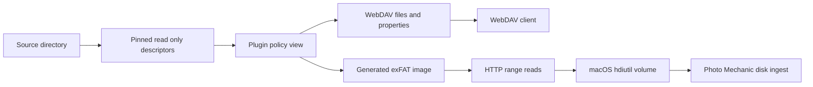

# diskproxy and stable camera ingest with virtual disks and WebDAV


A camera card I had already ingested started copying from the beginning after
my laptop changed timezones. The pictures were still there, the card identity
was still there, and the filenames had not changed. I wanted to resume an
interrupted ingest, not import thousands of old files again.

That problem became [diskproxy](https://github.com/firstpair/diskproxy), a Rust
program that presents a directory through a controlled, read-only filesystem
view. It can expose files through WebDAV or serve a generated exFAT disk over
HTTP. Application-specific behavior lives in plugins. The first plugin restores
a stable ingest convention for Photo Mechanic Plus; other policies can use the
same source access, HTTP server, and disk generator.

The interesting part is where the failure occurred: between a filesystem's
wall-clock timestamp and an application's expectation that modification time
is a stable part of file identity.

## The card that looked new again

Photo Mechanic calls copying photographs from a camera card to their destination
an ingest. Its Incremental Ingest option is intended to copy only photos new
since the previous ingest on that computer. That per-computer scope is part of
[Camera Bits' documented workflow](https://docs.camerabits.com/support/solutions/articles/48000207409-ingesting-photos).

In the local history files we inspected, an entry combined a card-relative path,
file size, and an epoch modification timestamp. The card's `.pmingest.dat`
contained the GUID selecting a history file under:

```text
~/Library/Caches/Photo Mechanic/ingest/incremental/<GUID>
```

A representative entry referred to `DCIM/100LEICA/ALXY8703.DNG`, a file of
42,484,224 bytes. Its recorded modification time in the original Pacific-time
ingest history was `1789413132`.

Rebuilding that history from the currently mounted card, and leaving out genuinely
new files, made incremental ingest behave again. That was useful evidence: the
application could recognize the existing pictures when supplied with matching
status data. It was also an inconvenient repair to repeat while traveling,
especially after an interrupted ingest.

The modification times provided the explanation. The same on-card wall-clock
value, September 14, 2026 at 12:12:12, became different epoch values on different
mounts:

| Timezone used for the mount | Reported epoch mtime | Change from the original history |
| --- | ---: | ---: |
| Pacific daylight time, UTC−07:00 | 1789413132 | 0 seconds |
| Shanghai, UTC+08:00 | 1789359132 | −54,000 seconds |
| Tokyo, UTC+09:00 | 1789355532 | −57,600 seconds |

Those differences are exactly fifteen and sixteen hours. The application was
being handed different timestamps for the same source entries.

## Epoch time was not the thing changing

Unix epoch timestamps identify instants independently of timezone. The conversion
*into* an epoch timestamp still needs a timezone if its input is only a local
clock reading. “12:12:12” without an offset does not identify one instant.

The inspected card came from a Leica M10-R running firmware 30.22.23.34. Its
exFAT creation and modification offset bytes were `0x00` on the 9,037 image
entries examined. In exFAT, an offset includes a validity bit. When it is invalid,
the specification directs implementations to use the current local offset for
the corresponding timestamp. This behavior is described in
[the exFAT timestamp specification](https://learn.microsoft.com/en-us/windows/win32/fileio/exfat-specification#74102-offsetvalid-field).

In our macOS tests, the timezone in effect at mounting determined the conversion.
Changing the laptop's timezone while the card remained mounted did not immediately
change the reported file times; remounting did. The camera's timezone menu had
not supplied a usable offset in those filesystem fields.

That observation belongs to this card and workflow. It does not establish that
every Leica model, firmware version, or filesystem driver behaves identically.
It does establish why a path/size/mtime comparison failed here.

The camera's EXIF capture time is a separate part of the story. Correcting an
incorrect camera clock, deciding which local date belongs in a filename, and
normalizing filesystem metadata for ingest are different operations. Diskproxy
handles the filesystem view. It does not rewrite EXIF or infer the actual place
and timezone in which a photograph was taken.

## WebDAV gave us a filesystem view in user space

WebDAV means **Web Distributed Authoring and Versioning**. It extends HTTP with
properties, collections, and operations for managing resources. A collection
can represent a directory, and `PROPFIND` lets a client ask for metadata and
members. That is the useful filesystem-like layer over ordinary HTTP.
[RFC 4918](https://www.rfc-editor.org/rfc/rfc4918.html) defines the protocol.

That made WebDAV an attractive first interface. A small local server could read
the physical card, return stable modification times, and let a mounted client
see the resulting tree. The photographs did not need to be staged into another
directory before ingest.

The implementation serves a deliberately read-only subset:

| Request | What diskproxy does |
| --- | --- |
| `OPTIONS` | Advertises the available DAV/read methods. |
| `PROPFIND` | Returns properties for an entry or one level of children. |
| `GET` | Streams the visible file's bytes. |
| `HEAD` | Returns its headers without the body. |

For example, a client can ask for names, lengths, and modification times beneath
a collection. Diskproxy formats a `207 Multi-Status` XML response. It checks the
namespace and local property name rather than assuming the client's XML prefix
will be `D` or `DAV`. It escapes values, encodes URL components, and gives unknown
properties their own failure status inside the response.

The server rejects mutation requests. A file's visible modification time comes
from the selected policy; its bytes come from the source descriptor. A policy
can also omit a file. Direct requests for an omitted file are checked too, so
filtering does more than remove a name from a listing.

A low-level WebDAV session looks like this:

```sh
diskproxy-server serve /path/to/folder --plugin passthrough --mode webdav
```

The server prints a localhost URL containing a random capability token. A WebDAV
client can mount that URL. The ordinary `diskproxy start` workflow uses the disk
transport described below, so normal ingest does not involve copying that URL.

## A folder view was not enough for this ingest workflow

The first unfiltered WebDAV attempt corrected timestamps, but Photo Mechanic did
not list it as a camera disk. Selecting the mounted share as a folder led to a
second mismatch: the application recorded folder and disk ingest paths differently.

We observed both forms for the same relative photo path:

```text
/DCIM/100LEICA/ALXY7590.DNG
DCIM/100LEICA/ALXY7590.DNG
```

The leading slash was enough to matter to that history comparison. In the failed
trial, ingest began copying previously ingested frames again. Correcting only
the modification time had left another part of the application's source identity
contract unsatisfied.

Two useful responses came out of that result. A filtering policy could normalize
those path forms and hide exact matches from the view. And a virtual disk could
preserve the disk-style source interface that the successful workflow expected.
WebDAV remains an alternative transport; the current PMP ingest launcher uses
the virtual disk.

## The virtual disk is generated over HTTP

Disk mode exposes one resource, `card.img`, as a read-only exFAT disk image.
macOS attaches it with `hdiutil` and presents an ordinary mounted volume that
Photo Mechanic can select under **Disks**.

This is an HTTP-backed disk image, rather than a WebDAV-mounted directory. Its
client reads disk-image byte offsets. HTTP Range requests allow transfer of a
portion of a representation, as specified in
[RFC 9110](https://www.rfc-editor.org/rfc/rfc9110.html#section-14.2). Diskproxy
supports single byte ranges, including suffix and open-ended forms.

The image does not have to exist as a large file on the laptop. Diskproxy builds
its boot structures, allocation information, directory entries, and other
filesystem metadata in memory. File-data extents refer back to the original
source files. A read can therefore be answered from generated metadata, zero
padding, or the appropriate range of source bytes.

The resulting data path has two possible client interfaces:



The virtual exFAT entries contain valid UTC offsets. The policy determines the
epoch timestamp; the disk generator encodes it in UTC. This removes the unknown-
offset conversion that caused the original remount problem.

The legacy card's virtual view matched all 7,777 known file entries in the checked
history. Ingest then resumed at frame 1480, the expected first new frame. A full
SHA-256 comparison of that representative DNG matched between source and view.
Later, a new card registered with a UTC convention was ingested successfully.
Those were workflow checks, rather than a throughput benchmark or a claim about
all cameras.

## The core owns the transports and the plugin owns the policy

The first implementation naturally accumulated camera-specific assumptions:
`DCIM`, `.pmingest.dat`, ingest-history rows, and timezone corrections. Extracting
it into diskproxy made those boundaries explicit.

The reusable core opens a source root, validates traversals, provides metadata,
streams files, and generates the disk. The PMP plugin supplies the camera layout,
card identity, timestamp convention, and optional history filtering. Configuration
and CLI selection live in the application. The shell launcher owns attachment
and process lifecycle.

The public plugin trait has three hooks:

```rust
fn visible(&self, parts: &[String], metadata: &Metadata) -> Result<bool>;
fn mtime(&self, parts: &[String], metadata: &Metadata) -> Result<i64>;
fn identity(&self) -> Option<String>;
```

Default implementations expose the entry, retain its modification time, and let
the core derive volume identity from the source. A simple visibility policy only
needs to override the first method. A timestamp policy can retain every file and
override the second. The PMP plugin uses a stable card identifier for the third.

A `View` combines a pinned `Source`, an `Arc<dyn Plugin>`, and a volume label.
Both transports use that same view. The core's source opens remain read-only
regardless of a visibility or timestamp decision.

Plugins are trusted Rust code linked into the binary. They are not dynamically
loaded scripts, and the trait is not a sandbox. A user-written plugin can call
other APIs; keeping setup writes small and explicit is part of writing a policy
responsibly.

## A UTC card is a stable ingest convention

For a fresh card with no prior ingest history, UTC is a convenient target. It
avoids having to remember whether that card first met the application in
Shanghai, Tokyo, or the Pacific timezone.

The target is an ingest convention. It does not assert that an offset-free EXIF
clock reading was UTC when the photograph was taken. A legacy card whose history
was established using Pacific daylight time must retain that convention until
its history is deliberately migrated. The saved profile prevents an accidental
target change.

The portable profile lives on the card as `.pmp-ingest-proxy.json`. It records
the GUID, target convention, and up to three sampled image fingerprints with
filesystem wall-clock anchors. Subsequent mounts can reconstruct the source
mount offset from unchanged samples. It does not infer that offset by treating
EXIF as a trusted clock.

Hashing a few samples serves a different purpose from filtering all ingest
history. The profile checks whether a sample is still the same file before using
its timestamp anchor. History filtering compares each candidate's relative path,
size, and presented mtime; it is not a whole-card content-deduplication service.

A profile travels between Macs, but Photo Mechanic's ingest progress remains
local to each computer. Another Mac does not automatically inherit the first
Mac's history. The filtered policy needs an available trusted history snapshot;
a profile alone does not tell it what another computer copied.

## Registration and ingestion now have short commands

Install the PMP use case from the repository:

```sh
git clone https://github.com/firstpair/diskproxy.git
cd diskproxy
scripts/install.sh --config configs/pmp.json
```

The installer preserves an existing default config; the
[PMP guide](https://github.com/firstpair/diskproxy/blob/main/plugins/pmp/README.md)
explains explicit config selection when one is already present. Once the PMP
config is the default, a new card needs one setup command:

```sh
diskproxy-server
```

It loads the default config, assumes the Mac's current UTC offset for the new
mount, selects UTC for a new card without history, writes the marker/profile,
and exits. If `diskproxy start` encounters an unregistered card first, its normal
message is simply:

```text
Run diskproxy-server.
```

Non-default paths or configs are included only when needed. Invalid configuration
or unverified existing samples produce diagnostics and override options. Repeating
the bare registration command on an established card reuses its profile.

Initial offset inference has a clear boundary: if the computer's timezone changed
*after* the card was mounted, the current offset may not describe that mount.
Remount first or specify the known mount offset, for example
`diskproxy-server --source-offset=+09:00`. An old card without a profile or usable
local history also needs its historical target convention supplied deliberately;
it should not be casually assigned a new UTC identity.

Ordinary sessions are shorter still:

```sh
diskproxy start
# Ingest the virtual volume under Disks in PMP.
diskproxy stop
```

The launcher starts the server, reads its capability URL, and attaches the disk.
Stop verifies the volume identity and detaches before terminating the server.
If macOS reports the volume busy, the server remains alive so an application
reading it can finish. The historical volume label, `PMP Pacific`, remains a
compatibility default even for UTC profiles; it does not determine the timestamp
policy.

Intended EXIF corrections should be completed and reviewed before profile
sampling, or handled on ingested destinations through the chosen catalog
workflow. Editing sampled source files later can invalidate the anchors. The
proxy preserves source photo bytes during serving and never renames pictures.

## Adding a plugin is a concrete build step

A general-purpose tool needs an extension path that another developer can
actually follow. The repository now contains a small, compiled reference crate
at `examples/hide-plugin` and a complete
[plugin development guide](https://github.com/firstpair/diskproxy/blob/main/docs/plugins.md).

The example accepts exact names and suffixes to exclude. Its core decision is:

```rust
impl Plugin for Hide {
    fn visible(&self, parts: &[String], _metadata: &Metadata) -> Result<bool> {
        Ok(!parts.iter().any(|part| {
            self.config.exclude_names.contains(part)
                || self.config.exclude_suffixes.iter()
                    .any(|suffix| part.ends_with(suffix))
        }))
    }
}
```

Checking every component is intentional. Hiding `cache` in a listing should also
hide `cache/secret.txt` when a client asks for that URL directly. The example's
constructor rejects malformed or empty match rules, and its default timestamp
and identity hooks leave those parts of the view alone.

The reference crate is tested as a workspace member. Selecting it from the CLI
requires registration in the application; it is not another automatically
loaded plugin. The required integration is specific:

1. Add the crate to the Cargo workspace and the application's dependencies.
2. Add its name to the Serde/Clap `PluginName` enum.
3. Deserialize and validate `plugins.<name>` before any setup I/O.
4. Add the construction arm that returns the pinned source, policy object,
   startup information, and default label.
5. Update the lockfile, build, and test both visible and hidden access paths.

The included `register.patch` performs those application edits for the example.
It has been applied and compiled in an isolated copy, then exercised through
WebDAV against a synthetic tree. It checked retained bytes, filtered listings,
direct requests for excluded descendants, and preservation of the physical files.
To reproduce that integration from the root of an experimental checkout:

```sh
git apply --check examples/hide-plugin/register.patch
git apply examples/hide-plugin/register.patch
cargo test --workspace --locked
```

After registering the example, save its definitions as `my-hide.json`, using
an absolute source path:

```json
{
  "source": "/absolute/path/to/folder",
  "plugin": "hide",
  "label": "HideDemo",
  "plugins": {
    "hide": {
      "exclude_names": ["cache", ".DS_Store"],
      "exclude_suffixes": [".tmp"]
    }
  }
}
```

Build/install that integrated binary, then the familiar lifecycle remains:

```sh
scripts/install.sh
diskproxy --config ./my-hide.json start
diskproxy stop
```

Or change a definition for one session:

```sh
diskproxy start --config ./my-hide.json \
  --set 'plugins.hide.exclude_suffixes=[".tmp",".bak"]'
```

The shipped application continues to select its built-in passthrough or PMP
policy until those example registry changes are applied. The public API currently
changes visibility, mtime, and volume identity. It does not provide arbitrary
file-content rewriting, path renaming, or a chain of multiple policies.

## The limits matter to the workflow

The HTTP service binds to localhost and gives each session a fresh 192-bit
capability token. Mutation methods are rejected. Source traversal rejects
symlinks, traversal components, and special files. These are useful boundaries
for a local read-only tool, not a remote multi-user storage service.

A running virtual disk is a snapshot of metadata with live source bytes behind
it. Keep the source stable. Size/mtime changes cause source-extent reads to fail;
restart after an intended edit. The filtered history is also a session snapshot,
so completing another ingest does not dynamically remove entries from a running
view. Stop/start to load the newer history.

Disk mode currently requires UTF-8 exFAT-compatible names and timestamps in the
1980–2107 range. Its upcase table folds ASCII letters; non-ASCII case folding is
not implemented. The server builds on Unix, while the automatic mounting
workflow is macOS-specific. These limits belong in choosing where to use it,
particularly for generic document trees rather than camera cards.

For the original problem, the useful abstraction is now small enough to reuse:
keep the source descriptors and transport machinery in one core, and let a
policy state the application's view of those files. The [public repository](https://github.com/firstpair/diskproxy),
[WebDAV and disk guide](https://github.com/firstpair/diskproxy/blob/main/docs/webdav.md), and [plugin development guide](https://github.com/firstpair/diskproxy/blob/main/docs/plugins.md)
provide the implementation and the steps to adapt it to another workflow.
